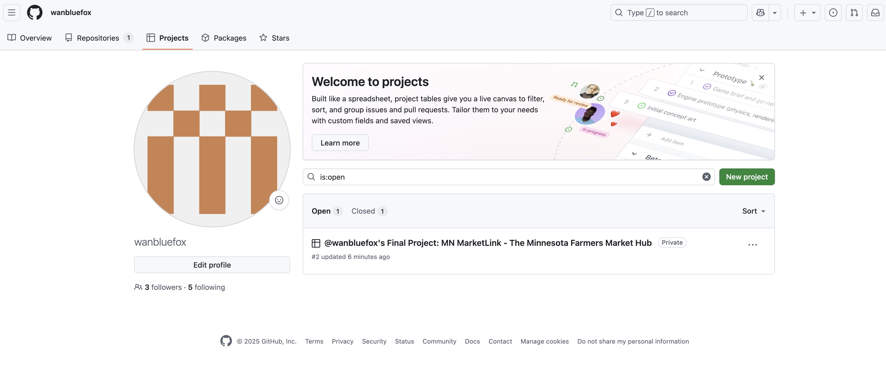
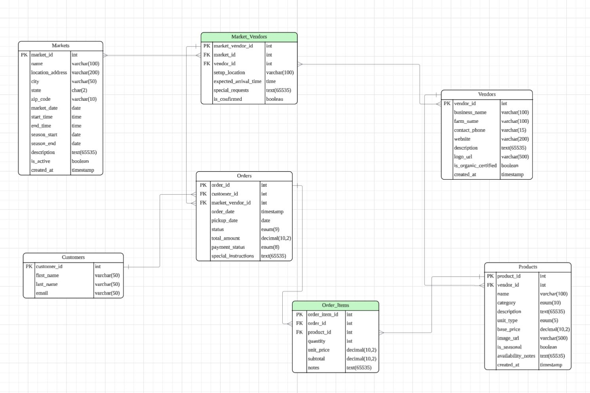

# se3050
class project
Team members:Jackie Xiong, William Xiong,Xuehai Wan

## Project Management
Our GitHub Projects board: 


https://trello.com/invite/b/68ca3a2cce1e360f2c05134b/ATTI60127e67a64b1602d6b63e80ba30e6acDF86FF7B/我的-trello-面板


# Milestone 2: Database Modeling & Design for MN MarketLink

## Project Proposal

### Application Features Overview

**MN MarketLink** is a comprehensive platform connecting Minnesota farmers markets with local communities. Key features include:

1. **Market Discovery**: Browse all farmers markets by location, date, and season
2. **Product Catalog**: Detailed product listings with availability, pricing, and seasonal information
3. **Pre-Order System**: Customers browse products and place pre-orders for market pickup
4. **Search & Filtering**: Advanced search across markets, vendors, and products

### Core Entities & Relationships
- **Markets**: Physical locations hosting farmers markets on specific dates
- **Vendors**: Farmers/businesses selling at markets
- **Products**: Items available for sale by vendors
- **Customers**: Users placing pre-orders
- **Orders**: Pre-order transactions linking customers, vendors, products, and markets
- **Market_Vendors**:This is a junction table (also called an associative or bridge table) that connects Markets and Vendors. It resolves the many-to-many relationship between them by storing details specific to a vendor's participation in a particular market (e.g., their booth setup). Without this, you couldn't track which vendors are attending which markets or add event-specific info.

---

## Entity-Relationship Diagram (ERD)

### Core Entities & Attributes

#### 1. Markets
- **market_id** (PK, INT)
- **name** (VARCHAR(100))
- **location_address** (VARCHAR(200))
- **city** (VARCHAR(50))
- **state** (CHAR(2)) DEFAULT 'MN'
- **zip_code** (VARCHAR(10))
- **market_date** (DATE)
- **start_time** (TIME)
- **end_time** (TIME)
- **season_start** (DATE)
- **season_end** (DATE)
- **description** (TEXT)
- **is_active** (BOOLEAN) DEFAULT TRUE
- **created_at** (TIMESTAMP)

#### 2. Vendors
- **vendor_id** (PK, INT)
- **user_id** (FK, INT) → Users
- **business_name** (VARCHAR(100))
- **farm_name** (VARCHAR(100))
- **contact_phone** (VARCHAR(15))
- **website** (VARCHAR(200))
- **description** (TEXT)
- **logo_url** (VARCHAR(500))
- **is_organic_certified** (BOOLEAN)
- **created_at** (TIMESTAMP)

#### 3. Products
- **product_id** (PK, INT)
- **vendor_id** (FK, INT) → Vendors
- **name** (VARCHAR(100))
- **category** (VARCHAR(50)) ENUM('vegetables', 'fruits', 'dairy', 'meat', 'bakery', 'flowers', 'other')
- **description** (TEXT)
- **unit_type** (VARCHAR(20)) ENUM('lb', 'kg', 'each', 'bunch', 'dozen')
- **base_price** (DECIMAL(10,2))
- **image_url** (VARCHAR(500))
- **is_seasonal** (BOOLEAN)
- **availability_notes** (TEXT)
- **created_at** (TIMESTAMP)

#### 4. Market_Vendors (Junction Table)
- **market_vendor_id** (PK, INT)
- **market_id** (FK, INT) → Markets
- **vendor_id** (FK, INT) → Vendors
- **setup_location** (VARCHAR(100))
- **expected_arrival_time** (TIME)
- **special_requests** (TEXT)
- **is_confirmed** (BOOLEAN) DEFAULT FALSE


#### 5. Customers
- **customer_id** (PK, INT)
- **first_name** (VARCHAR(50)) 
- **last_name** (VARCHAR(50))
- **email** (VARCHAR(50)) 


#### 6. Orders
- **order_id** (PK, INT)
- **customer_id** (FK, INT) → Customers
- **market_vendor_id** (FK, INT) → Market_Vendors
- **order_date** (TIMESTAMP)
- **pickup_date** (DATE)
- **status** (ENUM('pending', 'confirmed', 'ready', 'picked_up', 'cancelled'))
- **total_amount** (DECIMAL(10,2))
- **payment_status** (ENUM('pending', 'paid', 'refunded'))
- **special_instructions** (TEXT)

#### 7. Order_Items
- **order_item_id** (PK, INT)
- **order_id** (FK, INT) → Orders
- **product_id** (FK, INT) → Products
- **quantity** (INT)
- **unit_price** (DECIMAL(10,2))
- **subtotal** (DECIMAL(10,2))
- **notes** (TEXT)

### Key Relationships

1. **Markets ↔ Market_Vendors ↔ Vendors** (Many-to-Many)
   - A market has many vendors attending
   - A vendor can attend multiple markets
   - Junction table captures specific attendance details

2. **Vendors → Products** (One-to-Many)
   - Each vendor offers multiple products
   - Products belong to one vendor


4. **Customers → Orders** (One-to-Many)
   - Customers place multiple orders over time

5. **Orders → Order_Items** (One-to-Many)
   - Each order contains multiple products

6. **Market_Vendors → Orders** (One-to-Many)
   - Orders are tied to specific vendor attendance at markets

### Cardinality Summary
-- Markets 1 ↔ * Market_Vendors * ↔ 1 Vendors

-- Vendors 1 → * Products

-- Customers 1 → * Orders

-- Orders 1 → * Order_Items

-- Market_Vendors 1 → * Orders

-- Products * ← * Order_Items

### Normalization Analysis (Preview for Milestone 3)

-- **1NF**: All attributes atomic, no repeating groups

-- **2NF**: No partial dependencies (all non-key attributes depend on entire PK)

-- **3NF**: No transitive dependencies (non-key attributes depend only on candidate keys)

### Business Rules Implemented

1, Orders only valid for confirmed vendor market attendance
2, Product availability scoped to vendor-market combinations 
3, Orders track complete lifecycle from placement to pickup
4, Pricing captured at order time (historical accuracy)

### Sample Queries Enabled by Design

-- Find all vendors at a specific market with their products
-- Search products across markets by category and availability
-- Generate order summaries for vendors per market
-- Track customer order history

### ERD Visualization



### Schema Preview (SQL Script for Implementation)
This SQL script is a preview of how the ERD would be implemented in MySQL. It can be run in MySQL Workbench to create the schema, and the EER diagram can be generated via "Database > Reverse Engineer" for validation or import the data into Lucidchart. This is provided as a bridge to Milestone 3.

```sql
-- SQL Script for MySQL Workbench
-- This script creates the tables for the MN MarketLink ERD.

CREATE DATABASE IF NOT EXISTS mn_marketlink;
USE mn_marketlink;

-- 1. Markets
CREATE TABLE Markets (
    market_id INT AUTO_INCREMENT PRIMARY KEY,
    name VARCHAR(100) NOT NULL,
    location_address VARCHAR(200) NOT NULL,
    city VARCHAR(50) NOT NULL,
    state CHAR(2) DEFAULT 'MN',
    zip_code VARCHAR(10) NOT NULL,
    market_date DATE,
    start_time TIME,
    end_time TIME,
    season_start DATE,
    season_end DATE,
    description TEXT,
    is_active BOOLEAN DEFAULT TRUE,
    created_at TIMESTAMP DEFAULT CURRENT_TIMESTAMP
);

-- 5. Users (created early due to FK dependencies)
CREATE TABLE Users (
    user_id INT AUTO_INCREMENT PRIMARY KEY,
    email VARCHAR(255) UNIQUE NOT NULL,
    password_hash VARCHAR(255) NOT NULL,
    first_name VARCHAR(50),
    last_name VARCHAR(50),
    phone VARCHAR(15),
    user_type ENUM('customer', 'vendor', 'admin', 'market_manager') NOT NULL,
    is_active BOOLEAN DEFAULT TRUE,
    created_at TIMESTAMP DEFAULT CURRENT_TIMESTAMP,
    last_login TIMESTAMP
);

-- 2. Vendors
CREATE TABLE Vendors (
    vendor_id INT AUTO_INCREMENT PRIMARY KEY,
    user_id INT,
    business_name VARCHAR(100) NOT NULL,
    farm_name VARCHAR(100),
    contact_phone VARCHAR(15),
    website VARCHAR(200),
    description TEXT,
    logo_url VARCHAR(500),
    is_organic_certified BOOLEAN,
    created_at TIMESTAMP DEFAULT CURRENT_TIMESTAMP,
    FOREIGN KEY (user_id) REFERENCES Users(user_id) ON DELETE CASCADE
);

-- 3. Products
CREATE TABLE Products (
    product_id INT AUTO_INCREMENT PRIMARY KEY,
    vendor_id INT NOT NULL,
    name VARCHAR(100) NOT NULL,
    category ENUM('vegetables', 'fruits', 'dairy', 'meat', 'bakery', 'flowers', 'other') NOT NULL,
    description TEXT,
    unit_type ENUM('lb', 'kg', 'each', 'bunch', 'dozen') NOT NULL,
    base_price DECIMAL(10,2) NOT NULL,
    image_url VARCHAR(500),
    is_seasonal BOOLEAN,
    availability_notes TEXT,
    created_at TIMESTAMP DEFAULT CURRENT_TIMESTAMP,
    FOREIGN KEY (vendor_id) REFERENCES Vendors(vendor_id) ON DELETE CASCADE
);

-- 4. Market_Vendors (Junction Table)
CREATE TABLE Market_Vendors (
    market_vendor_id INT AUTO_INCREMENT PRIMARY KEY,
    market_id INT NOT NULL,
    vendor_id INT NOT NULL,
    setup_location VARCHAR(100),
    expected_arrival_time TIME,
    special_requests TEXT,
    is_confirmed BOOLEAN DEFAULT FALSE,
    FOREIGN KEY (market_id) REFERENCES Markets(market_id) ON DELETE CASCADE,
    FOREIGN KEY (vendor_id) REFERENCES Vendors(vendor_id) ON DELETE CASCADE
);

-- 6. Customers
CREATE TABLE Customers (
    customer_id INT AUTO_INCREMENT PRIMARY KEY,
    user_id INT NOT NULL,
    preferred_pickup_market INT,  
    FOREIGN KEY (user_id) REFERENCES Users(user_id) ON DELETE CASCADE,
    FOREIGN KEY (preferred_pickup_market) REFERENCES Markets(market_id) ON DELETE SET NULL
);

-- 7. Orders
CREATE TABLE Orders (
    order_id INT AUTO_INCREMENT PRIMARY KEY,
    customer_id INT NOT NULL,
    market_vendor_id INT NOT NULL,
    order_date TIMESTAMP DEFAULT CURRENT_TIMESTAMP,
    pickup_date DATE NOT NULL,
    status ENUM('pending', 'confirmed', 'ready', 'picked_up', 'cancelled') DEFAULT 'pending',
    total_amount DECIMAL(10,2) NOT NULL,
    payment_status ENUM('pending', 'paid', 'refunded') DEFAULT 'pending',
    special_instructions TEXT,
    FOREIGN KEY (customer_id) REFERENCES Customers(customer_id) ON DELETE CASCADE,
    FOREIGN KEY (market_vendor_id) REFERENCES Market_Vendors(market_vendor_id) ON DELETE CASCADE
);

-- 8. Order_Items
CREATE TABLE Order_Items (
    order_item_id INT AUTO_INCREMENT PRIMARY KEY,
    order_id INT NOT NULL,
    product_id INT NOT NULL,
    quantity INT NOT NULL,
    unit_price DECIMAL(10,2) NOT NULL,
    subtotal DECIMAL(10,2) NOT NULL,
    notes TEXT,
    FOREIGN KEY (order_id) REFERENCES Orders(order_id) ON DELETE CASCADE,
    FOREIGN KEY (product_id) REFERENCES Products(product_id) ON DELETE RESTRICT
);

-- Indexes for performance
CREATE INDEX idx_market_date ON Markets(market_date);
CREATE INDEX idx_vendor_id ON Products(vendor_id);
CREATE INDEX idx_product_category ON Products(category);
CREATE INDEX idx_order_status ON Orders(status);
CREATE INDEX idx_user_email ON Users(email);

```


