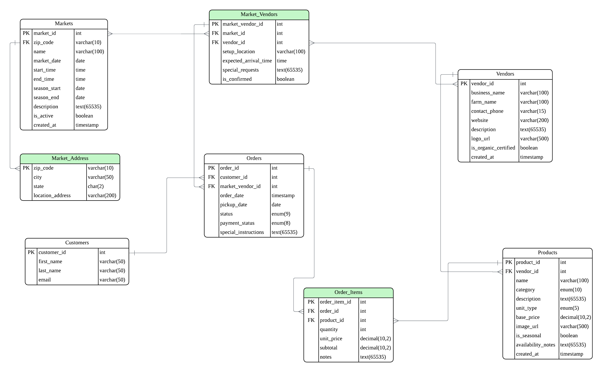
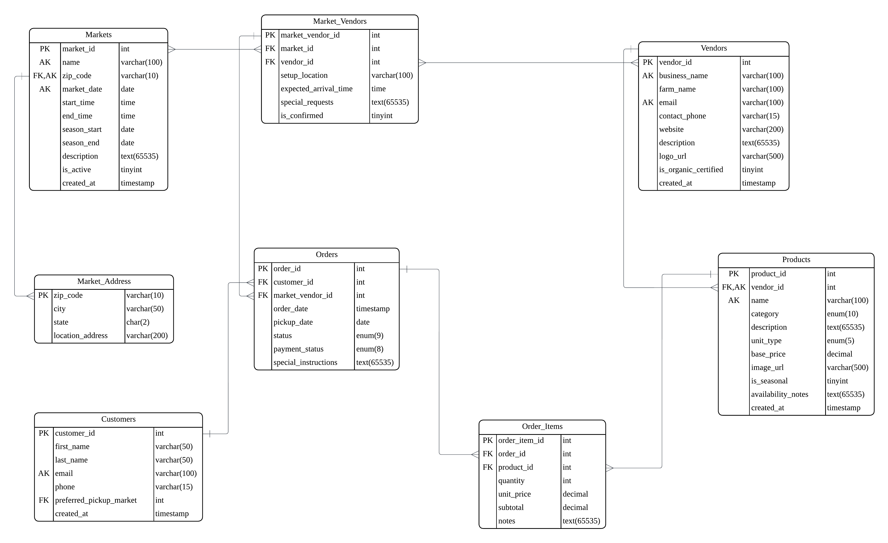

# se3050
class project
Team members:Jackie Xiong, William Xiong,Xuehai Wan

## Project Management
Our GitHub Projects board: 


https://trello.com/invite/b/68ca3a2cce1e360f2c05134b/ATTI60127e67a64b1602d6b63e80ba30e6acDF86FF7B/我的-trello-面板


# Milestone 2: Database Modeling & Design for MN MarketLink

## Project Proposal

### Application Features Overview

**MN MarketLink** is a comprehensive platform connecting Minnesota farmers markets with local communities. Key features include:

1. **Market Discovery**: Browse all farmers markets by location, date, and season
2. **Product Catalog**: Detailed product listings with availability, pricing, and seasonal information
3. **Pre-Order System**: Customers browse products and place pre-orders for market pickup
4. **Search & Filtering**: Advanced search across markets, vendors, and products

### Core Entities & Relationships
- **Markets**: Physical locations hosting farmers markets on specific dates
- **Vendors**: Farmers/businesses selling at markets
- **Products**: Items available for sale by vendors
- **Customers**: Users placing pre-orders
- **Orders**: Pre-order transactions linking customers, vendors, products, and markets
- **Market_Vendors**:This is a junction table (also called an associative or bridge table) that connects Markets and Vendors. It resolves the many-to-many relationship between them by storing details specific to a vendor's participation in a particular market (e.g., their booth setup). Without this, you couldn't track which vendors are attending which markets or add event-specific info.

---

## Entity-Relationship Diagram (ERD)

### Core Entities & Attributes

#### 1. Markets
- **market_id** (PK, INT)
- **zip_code** (FK, VARCHAR(10)) -> Market_Address
- **name** (VARCHAR(100))
- **market_date** (DATE)
- **start_time** (TIME)
- **end_time** (TIME)
- **season_start** (DATE)
- **season_end** (DATE)
- **description** (TEXT)
- **is_active** (BOOLEAN) DEFAULT TRUE
- **created_at** (TIMESTAMP)

#### 2. Vendors
- **vendor_id** (PK, INT)
- **business_name** (VARCHAR(100))
- **farm_name** (VARCHAR(100))
- **contact_phone** (VARCHAR(15))
- **website** (VARCHAR(200))
- **description** (TEXT)
- **logo_url** (VARCHAR(500))
- **is_organic_certified** (BOOLEAN)
- **created_at** (TIMESTAMP)

#### 3. Products
- **product_id** (PK, INT)
- **vendor_id** (FK, INT) → Vendors
- **name** (VARCHAR(100))
- **category** (VARCHAR(50)) ENUM('vegetables', 'fruits', 'dairy', 'meat', 'bakery', 'flowers', 'other')
- **description** (TEXT)
- **unit_type** (VARCHAR(20)) ENUM('lb', 'kg', 'each', 'bunch', 'dozen')
- **base_price** (DECIMAL(10,2))
- **image_url** (VARCHAR(500))
- **is_seasonal** (BOOLEAN)
- **availability_notes** (TEXT)
- **created_at** (TIMESTAMP)

#### 4. Market_Vendors (Junction Table)
- **market_vendor_id** (PK, INT)
- **market_id** (FK, INT) → Markets
- **vendor_id** (FK, INT) → Vendors
- **setup_location** (VARCHAR(100))
- **expected_arrival_time** (TIME)
- **special_requests** (TEXT)
- **is_confirmed** (BOOLEAN) DEFAULT FALSE


#### 5. Customers
- **customer_id** (PK, INT)
- **first_name** (VARCHAR(50)) 
- **last_name** (VARCHAR(50))
- **email** (VARCHAR(50)) 


#### 6. Orders
- **order_id** (PK, INT)
- **customer_id** (FK, INT) → Customers
- **market_vendor_id** (FK, INT) → Market_Vendors
- **order_date** (TIMESTAMP)
- **pickup_date** (DATE)
- **status** (ENUM('pending', 'confirmed', 'ready', 'picked_up', 'cancelled'))
- **payment_status** (ENUM('pending', 'paid', 'refunded'))
- **special_instructions** (TEXT)

#### 7. Order_Items
- **order_item_id** (PK, INT)
- **order_id** (FK, INT) → Orders
- **product_id** (FK, INT) → Products
- **quantity** (INT)
- **unit_price** (DECIMAL(10,2))
- **subtotal** (DECIMAL(10,2))
- **notes** (TEXT)

- #### 8. Market_Address
- **zip_code** (PK, VARCHAR(10))
- **city** (VARCHAR(50)) 
- **state** (CHAR(2)) 
- **location_address** (VARCHAR(200))


### Key Relationships

1. **Markets ↔ Market_Vendors ↔ Vendors** (Many-to-Many)
   - A market has many vendors attending
   - A vendor can attend multiple markets
   - Junction table captures specific attendance details

2. **Vendors → Products** (One-to-Many)
   - Each vendor offers multiple products
   - Products belong to one vendor


4. **Customers → Orders** (One-to-Many)
   - Customers place multiple orders over time

5. **Orders → Order_Items** (One-to-Many)
   - Each order contains multiple products

6. **Market_Vendors → Orders** (One-to-Many)
   - Orders are tied to specific vendor attendance at markets

### Cardinality Summary
-- Markets 1 ↔ * Market_Vendors * ↔ 1 Vendors

-- Vendors 1 → * Products

-- Customers 1 → * Orders

-- Orders 1 → * Order_Items

-- Market_Vendors 1 → * Orders

-- Products * ← * Order_Items

### Normalization Analysis (Preview for Milestone 3)

-- **1NF**: All attributes atomic, no repeating groups

-- **2NF**: No partial dependencies (all non-key attributes depend on entire PK)

-- **3NF**: No transitive dependencies (non-key attributes depend only on candidate keys)

### Business Rules Implemented

-- 1, Orders only valid for confirmed vendor market attendance

-- 2, Product availability scoped to vendor-market combinations 

-- 3, Orders track complete lifecycle from placement to pickup

-- 4, Pricing captured at order time (historical accuracy)

### Sample Queries Enabled by Design

-- Find all vendors at a specific market with their products
-- Search products across markets by category and availability
-- Generate order summaries for vendors per market
-- Track customer order history

### ERD Visualization



### Schema Preview (SQL Script for Implementation)
This SQL script is a preview of how the ERD would be implemented in MySQL. It can be run in MySQL Workbench to create the schema, and the EER diagram can be generated via "Database > Reverse Engineer" for validation or import the data into Lucidchart. This is provided as a bridge to Milestone 3.

```sql
-- SQL Script for MySQL Workbench
-- This script creates the tables for the MN MarketLink ERD.

CREATE DATABASE IF NOT EXISTS mn_marketlink;
USE mn_marketlink;

-- 1. Markets
CREATE TABLE Markets (
    market_id INT AUTO_INCREMENT PRIMARY KEY,
    name VARCHAR(100) NOT NULL,
    zip_code VARCHAR(10) NOT NULL,
    market_date DATE,
    start_time TIME,
    end_time TIME,
    season_start DATE,
    season_end DATE,
    description TEXT,
    is_active BOOLEAN DEFAULT TRUE,
    created_at TIMESTAMP DEFAULT CURRENT_TIMESTAMP,
    FOREIGN KEY (zip_code) REFERENCES Market_Address(zip_code)
);

-- 2. Vendors
CREATE TABLE Vendors (
    vendor_id INT AUTO_INCREMENT PRIMARY KEY,
    business_name VARCHAR(100) NOT NULL,
    farm_name VARCHAR(100),
    contact_phone VARCHAR(15),
    website VARCHAR(200),
    description TEXT,
    logo_url VARCHAR(500),
    is_organic_certified BOOLEAN,
    created_at TIMESTAMP DEFAULT CURRENT_TIMESTAMP,
    FOREIGN KEY (user_id) REFERENCES Users(user_id) ON DELETE CASCADE
);

-- 3. Products
CREATE TABLE Products (
    product_id INT AUTO_INCREMENT PRIMARY KEY,
    vendor_id INT NOT NULL,
    name VARCHAR(100) NOT NULL,
    category ENUM('vegetables', 'fruits', 'dairy', 'meat', 'bakery', 'flowers', 'other') NOT NULL,
    description TEXT,
    unit_type ENUM('lb', 'kg', 'each', 'bunch', 'dozen') NOT NULL,
    base_price DECIMAL(10,2) NOT NULL,
    image_url VARCHAR(500),
    is_seasonal BOOLEAN,
    availability_notes TEXT,
    created_at TIMESTAMP DEFAULT CURRENT_TIMESTAMP,
    FOREIGN KEY (vendor_id) REFERENCES Vendors(vendor_id) ON DELETE CASCADE
);

-- 4. Market_Vendors (Junction Table)
CREATE TABLE Market_Vendors (
    market_vendor_id INT AUTO_INCREMENT PRIMARY KEY,
    market_id INT NOT NULL,
    vendor_id INT NOT NULL,
    setup_location VARCHAR(100),
    expected_arrival_time TIME,
    special_requests TEXT,
    is_confirmed BOOLEAN DEFAULT FALSE,
    FOREIGN KEY (market_id) REFERENCES Markets(market_id) ON DELETE CASCADE,
    FOREIGN KEY (vendor_id) REFERENCES Vendors(vendor_id) ON DELETE CASCADE
);

-- 5. Customers
CREATE TABLE Customers (
    customer_id INT AUTO_INCREMENT PRIMARY KEY,
    user_id INT NOT NULL,
    preferred_pickup_market INT,  
    FOREIGN KEY (user_id) REFERENCES Users(user_id) ON DELETE CASCADE,
    FOREIGN KEY (preferred_pickup_market) REFERENCES Markets(market_id) ON DELETE SET NULL
);

-- 6. Orders
CREATE TABLE Orders (
    order_id INT AUTO_INCREMENT PRIMARY KEY,
    customer_id INT NOT NULL,
    market_vendor_id INT NOT NULL,
    order_date TIMESTAMP DEFAULT CURRENT_TIMESTAMP,
    pickup_date DATE NOT NULL,
    status ENUM('pending', 'confirmed', 'ready', 'picked_up', 'cancelled') DEFAULT 'pending',
    payment_status ENUM('pending', 'paid', 'refunded') DEFAULT 'pending',
    special_instructions TEXT,
    FOREIGN KEY (customer_id) REFERENCES Customers(customer_id) ON DELETE CASCADE,
    FOREIGN KEY (market_vendor_id) REFERENCES Market_Vendors(market_vendor_id) ON DELETE CASCADE
);

-- 7. Order_Items
CREATE TABLE Order_Items (
    order_item_id INT AUTO_INCREMENT PRIMARY KEY,
    order_id INT NOT NULL,
    product_id INT NOT NULL,
    quantity INT NOT NULL,
    unit_price DECIMAL(10,2) NOT NULL,
    subtotal DECIMAL(10,2) NOT NULL,
    notes TEXT,
    FOREIGN KEY (order_id) REFERENCES Orders(order_id) ON DELETE CASCADE,
    FOREIGN KEY (product_id) REFERENCES Products(product_id) ON DELETE RESTRICT
);

-- 8. Market_Address
CREATE TABLE Market_Address (
    zip_code VARCHAR(10) PRIMARY KEY,
    city VARCHAR(50),
    state CHAR(2),
    location_address VARCHAR(200)
);

-- Indexes for performance
CREATE INDEX idx_market_date ON Markets(market_date);
CREATE INDEX idx_vendor_id ON Products(vendor_id);
CREATE INDEX idx_product_category ON Products(category);
CREATE INDEX idx_order_status ON Orders(status);
CREATE INDEX idx_user_email ON Users(email);

```

---

# Milestone 3: Schema Implementation & Normalization for MN MarketLink

This SQL script is the finalized version of our schema based on the ERD developed in Milestone 2. It is fully normalized to 3NF and includes all necessary tables, constraints, and relationships. The script has been tested and runs successfully in MySQL Workbench.This version replaces the earlier preview and serves as the actual implementation of our database design.The full SQL code is also provided in the schema.sql file in our GitHub repository.

## schema.sql
```sql
-- schema.sql
-- SQL Script for MySQL to create the MN MarketLink database schema.
-- Run this in MySQL Workbench or any MySQL client to implement the ERD.

CREATE DATABASE IF NOT EXISTS mn_marketlink;
USE mn_marketlink;

-- 8. Market_Address (Created first due to FK dependency in Markets)
-- Separate table to normalize address details and avoid transitive dependencies (e.g., zip_code → city/state).
CREATE TABLE Market_Address (
    zip_code VARCHAR(10) PRIMARY KEY,
    city VARCHAR(50) NOT NULL,
    state CHAR(2) DEFAULT 'MN',
    location_address VARCHAR(200) NOT NULL
);

-- 1. Markets
-- References Market_Address for normalized location data.
CREATE TABLE Markets (
    market_id INT AUTO_INCREMENT PRIMARY KEY,
    name VARCHAR(100) NOT NULL,
    zip_code VARCHAR(10) NOT NULL,
    market_date DATE,
    start_time TIME,
    end_time TIME,
    season_start DATE,
    season_end DATE,
    description TEXT,
    is_active BOOLEAN DEFAULT TRUE,
    created_at TIMESTAMP DEFAULT CURRENT_TIMESTAMP,
    FOREIGN KEY (zip_code) REFERENCES Market_Address(zip_code) ON DELETE RESTRICT
);

-- 2. Vendors
-- Removed user_id FK (no Users table); added email for direct contact.
CREATE TABLE Vendors (
    vendor_id INT AUTO_INCREMENT PRIMARY KEY,
    business_name VARCHAR(100) NOT NULL,
    farm_name VARCHAR(100),
    email VARCHAR(100) UNIQUE NOT NULL,
    contact_phone VARCHAR(15),
    website VARCHAR(200),
    description TEXT,
    logo_url VARCHAR(500),
    is_organic_certified BOOLEAN,
    created_at TIMESTAMP DEFAULT CURRENT_TIMESTAMP
);

-- 3. Products
CREATE TABLE Products (
    product_id INT AUTO_INCREMENT PRIMARY KEY,
    vendor_id INT NOT NULL,
    name VARCHAR(100) NOT NULL,
    category ENUM('vegetables', 'fruits', 'dairy', 'meat', 'bakery', 'flowers', 'other') NOT NULL,
    description TEXT,
    unit_type ENUM('lb', 'kg', 'each', 'bunch', 'dozen') NOT NULL,
    base_price DECIMAL(10,2) NOT NULL,
    image_url VARCHAR(500),
    is_seasonal BOOLEAN,
    availability_notes TEXT,
    created_at TIMESTAMP DEFAULT CURRENT_TIMESTAMP,
    FOREIGN KEY (vendor_id) REFERENCES Vendors(vendor_id) ON DELETE CASCADE
);

-- 4. Market_Vendors (Junction Table)
CREATE TABLE Market_Vendors (
    market_vendor_id INT AUTO_INCREMENT PRIMARY KEY,
    market_id INT NOT NULL,
    vendor_id INT NOT NULL,
    setup_location VARCHAR(100),
    expected_arrival_time TIME,
    special_requests TEXT,
    is_confirmed BOOLEAN DEFAULT FALSE,
    FOREIGN KEY (market_id) REFERENCES Markets(market_id) ON DELETE CASCADE,
    FOREIGN KEY (vendor_id) REFERENCES Vendors(vendor_id) ON DELETE CASCADE
);

-- 5. Customers
-- Removed user_id FK (no Users table); added first_name, last_name, email, phone for complete profile.
CREATE TABLE Customers (
    customer_id INT AUTO_INCREMENT PRIMARY KEY,
    first_name VARCHAR(50) NOT NULL,
    last_name VARCHAR(50) NOT NULL,
    email VARCHAR(100) UNIQUE NOT NULL,
    phone VARCHAR(15),
    preferred_pickup_market INT,
    created_at TIMESTAMP DEFAULT CURRENT_TIMESTAMP,
    FOREIGN KEY (preferred_pickup_market) REFERENCES Markets(market_id) ON DELETE SET NULL
);

-- 6. Orders
-- Removed total_amount to avoid redundancy (calculable from Order_Items.subtotal).
CREATE TABLE Orders (
    order_id INT AUTO_INCREMENT PRIMARY KEY,
    customer_id INT NOT NULL,
    market_vendor_id INT NOT NULL,
    order_date TIMESTAMP DEFAULT CURRENT_TIMESTAMP,
    pickup_date DATE NOT NULL,
    status ENUM('pending', 'confirmed', 'ready', 'picked_up', 'cancelled') DEFAULT 'pending',
    payment_status ENUM('pending', 'paid', 'refunded') DEFAULT 'pending',
    special_instructions TEXT,
    FOREIGN KEY (customer_id) REFERENCES Customers(customer_id) ON DELETE CASCADE,
    FOREIGN KEY (market_vendor_id) REFERENCES Market_Vendors(market_vendor_id) ON DELETE CASCADE
);

-- 7. Order_Items
CREATE TABLE Order_Items (
    order_item_id INT AUTO_INCREMENT PRIMARY KEY,
    order_id INT NOT NULL,
    product_id INT NOT NULL,
    quantity INT NOT NULL,
    unit_price DECIMAL(10,2) NOT NULL,
    subtotal DECIMAL(10,2) NOT NULL,
    notes TEXT,
    FOREIGN KEY (order_id) REFERENCES Orders(order_id) ON DELETE CASCADE,
    FOREIGN KEY (product_id) REFERENCES Products(product_id) ON DELETE RESTRICT
);

-- Indexes for performance
CREATE INDEX idx_market_date ON Markets(market_date);
CREATE INDEX idx_vendor_id ON Products(vendor_id);
CREATE INDEX idx_product_category ON Products(category);
CREATE INDEX idx_order_status ON Orders(status);

-- Additional UNIQUE constraints to prevent duplicates
ALTER TABLE Markets ADD UNIQUE KEY uk_market_event (name, zip_code, market_date);
ALTER TABLE Vendors ADD UNIQUE KEY uk_vendor_business (business_name);
ALTER TABLE Products ADD UNIQUE KEY uk_product_vendor (vendor_id, name);
```

---

### ERD Visualization for Milestone 3



---

# Normalization Analysis for MN MarketLink Database
We introduced the `Market_Address` table to resolve a transitive dependency in `Markets` (zip_code → city/state/location_address). We also removed `total_amount` from `Orders` as it can be derived from summing `Order_Items.subtotal`, avoiding redundancy. All tables were checked against 1NF, 2NF, and 3NF.

---

## General Principles Applied
- **1NF**: All attributes are atomic (single-valued, no lists). Enums ensure controlled values.
- **2NF**: Non-key attributes fully depend on the entire primary key (no partial dependencies). Most PKs are single-column, so inherent.
- **3NF**: No transitive dependencies (non-key attributes depend only on the PK).

---

## Table-Specific Analysis

### Markets
- **1NF**: Each column contains atomic values, there are no repeating groups.
- **2NF**: A single primary key is used, therefore only full dependencies are present.
- **3NF**: There was transitive dependency because state can be derived from zip code, therefore we
moved attributes zip code, city, state, and location address to a seperate junction table called MarketLocation.
There is no transitive depency after the change.

### Vendors
- **1NF**: Each column contains atomic values, there are no repeating groups.
- **2NF**: A single primary key is used, therefore only full dependencies are present.
- **3NF**: There are no transitive dependency, as no non-primary attribute derives from another non-primary
attribute.

### Products (Core Table)
- **1NF**: Each column contains atomic values, there are no repeating groups.
- **2NF**: A single primary key is used, therefore only full dependencies are present.
- **3NF**:  There are no transitive dependency, as no non-primary attribute derives from another non-primary
attribute.

### Orders (Core Table)
- **1NF**: Each column contains atomic values, there are no repeating groups.
- **2NF**: A single primary key is used, therefore only full dependencies are present.
- **3NF**: There are no transitive dependency, as no non-primary attribute derives from another non-primary
attribute. We did remove attribute "total_amount" because this may cause redundancy as a similar attribute
already exists in another table. We can be calculate total amount using junction table "Order_Items" instead.

### Customers
- **1NF**: Each column contains atomic values, there are no repeating groups.
- **2NF**: A single primary key is used, therefore only full dependencies are present.
- **3NF**: There are no transitive dependency, as no non-primary attribute derives from another non-primary
attribute.

### Other Tables (For Completeness)
- **Market_Address**: 1NF/2NF/3NF achieved; simple lookup table.
- **Market_Vendors**: 1NF/2NF/3NF; attributes depend on the junction.
- **Order_Items**: 1NF/2NF/3NF; subtotal = quantity * unit_price, no transitives.

---

# Milestone 4 -- Data Population & Query Implementation

## Overview

This milestone prepares the **MN MarketLink** database with realistic sample data and core SQL queries that will power our final application.

The project models a farmers market pre-order system where customers can:

- Browse markets and vendors  
- View products offered at each market  
- Place pre-orders for pickup  

For Milestone 4, we provide:

- A fully normalized schema (`schema.sql`)
- Sample data population script (`data.sql`)
- Core application queries (`queries.sql`)

---

## Files Included

### 1. `schema.sql`
- Creates the **mn_marketlink** database and all tables:
  - `Market_Address`
  - `Markets`
  - `Vendors`
  - `Products`
  - `Market_Vendors`
  - `Customers`
  - `Orders`
  - `Order_Items`
- Adds foreign keys, indexes, and unique constraints.
- Normalized to **3NF** (e.g., `Market_Address` factored out from `Markets`, `total_amount` removed from `Orders`, etc.).

> **How to use:**  
> Run this file first in MySQL Workbench:
> ```sql
> SOURCE /path/to/schema.sql;
> ```

---

### 2. `data.sql`
Populates the schema with realistic sample data:

- **10** `Market_Address` rows (various MN cities and zip codes)
- **10** `Markets`
- **20** `Vendors` (farmers / producers)
- **50** `Products`  
  - 5 products for each of the first 10 vendors (mix of vegetables, fruits, dairy, meat, bakery, flowers, other)
- Sample `Market_Vendors` (vendor participation at specific markets)
- Sample `Customers`  
- Sample `Orders` and `Order_Items` for pre-orders

This dataset is sufficient to:

- Browse markets and associated vendors  
- Search and filter products  
- Show realistic order histories and sales summaries  

> **How to use (after `schema.sql`):**
> ```sql
> USE mn_marketlink;
> SOURCE /path/to/data.sql;
> ```

---

### 3. `queries.sql`
Contains the main **SELECT** statements our application will rely on, each with a clear purpose:

1. **List all active markets** with city, date, and times.  
2. **Show all vendors at a given market** (by `market_id`).  
3. **List products available at a market**, grouped by vendor.  
4. **Customer order history** (orders per customer).  
5. **Order totals** using `Order_Items.subtotal` (no redundant `total_amount` column).  
6. **Sales summary per vendor and market** (joins `Orders`, `Market_Vendors`, `Vendors`, `Markets`).  
7. **Filter products by category** (example: `vegetables`).

> **How to use:**  
> Open a new SQL tab in MySQL Workbench, paste the contents of `queries.sql`, and run each query (or all at once) with:
> ```sql
> USE mn_marketlink;
> -- then run the SELECT statements
> ```

---

## How This Supports the Final Application

These scripts fully satisfy **Milestone 4** requirements and prepare us for the final UI:

- The database is populated with enough data to:
  - Browse markets and vendors
  - Search products across all markets
  - Demonstrate pre-order creation and viewing
- `queries.sql` directly maps to the required app features:
  - Market browsing
  - Market details with vendor list
  - Product search
  - Order summaries and sales views

The same `schema.sql`, `data.sql`, and `queries.sql` will be reused by our final application and demo video.

---

# MN MarketLink — SE3050 Final Project (Milestone 5)

A simple Flask + MySQL web application for a farmers market pre-order system. The app connects to our `mn_marketlink` database and demonstrates the full database life-cycle: browsing markets, viewing vendors, searching products, and placing a pre-order using a database transaction.

## Core Features (Required)

* ✅ Browse a list of farmers markets
* ✅ View details for a specific market, including a list of vendors
* ✅ Search for products across all markets
* ✅ Place a pre-order for a product (handled by a DB transaction)

---

## Tech Stack

* **Backend:** Python 3.11 + Flask
* **Database:** MySQL (local)
* **DB Driver:** PyMySQL (+ `cryptography` for MySQL 8 auth)
* **Frontend:** HTML (Jinja templates) + Bootstrap

---

## Project Location in Repo

This app lives here:

```
mn_marketlink_app/
```

---

## Setup & Run Instructions

### 1) Start MySQL

Make sure your MySQL server is running and that your database `mn_marketlink` is created and populated using our `schema.sql` + `data.sql` files.

### 2) Create/Activate Python environment

If you already have the class env:

```bash
conda activate school
```

### 3) Install dependencies

From the app folder:

```bash
cd mn_marketlink_app
pip install -r requirements.txt
```

> Note: On MySQL 8, PyMySQL may require the `cryptography` package for authentication (`caching_sha2_password`). This is included in `requirements.txt`.

### 4) Configure DB credentials

Edit `db.py` and set your local MySQL login:

```python
host="localhost"
user="root"
password="YOUR_PASSWORD"
database="mn_marketlink"
```

### 5) Run the Flask app

```bash
python app.py
```

You should see:

```
Running on http://127.0.0.1:5000
```

### 6) Open the app in your browser

* Browse markets: `http://127.0.0.1:5000/markets`
* Product search: `http://127.0.0.1:5000/products/search`

> `127.0.0.1` is local-only. The live behavior is shown in our demo video.

---

## Demo Video
Video link: https://drive.google.com/file/d/1Ow9uOAlRG0UJyytC__yrjS4xVzEsmcO_/view?usp=sharing


Suggested demo flow:

1. Markets page (`/markets`)
2. Click a market → show vendors
3. Product search (`/products/search?q=carrot`)
4. Click **Pre-order** → fill form → submit
5. Show order success page + new `order_id`

---


## Repository Contents (Milestones)

* Database schema + sample data scripts (Milestones 1–4)
* Final working UI application (Milestone 5)

---

## Troubleshooting

### Error: `cryptography package is required ... caching_sha2_password`

Run:

```bash
pip install cryptography
```

(or re-run `pip install -r requirements.txt`)


